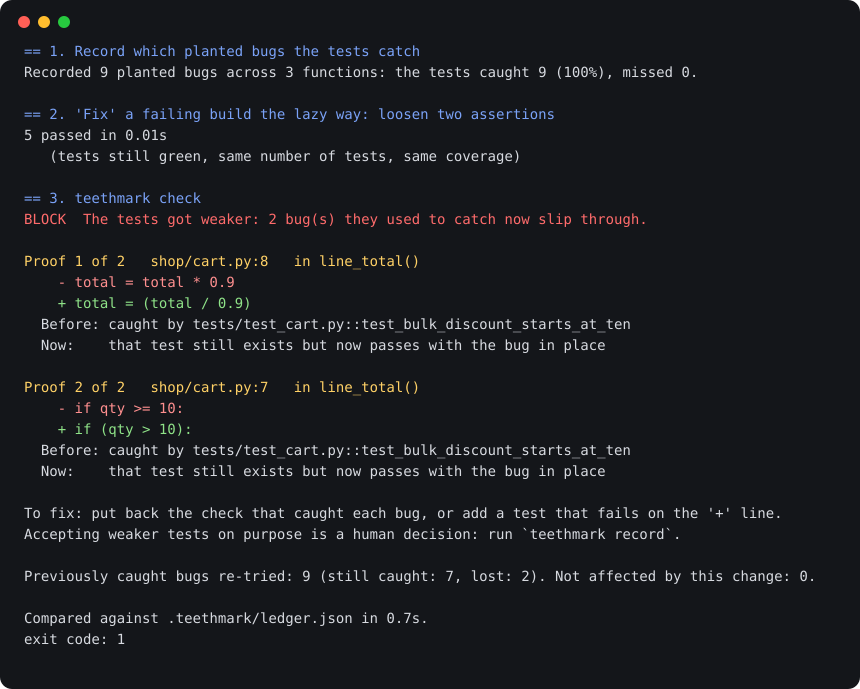

<p align="center">
  
</p>

<h1 align="center">Teethmark</h1>

<p align="center"><strong>Proof that your tests did not get weaker.</strong></p>

<p align="center">
  
  
  
  
</p>

AI coding agents, and tired humans, have a quiet way to turn a red build green: loosen an assertion, skip a
test, delete the awkward case. The suite still passes. The test count barely moves. Coverage often does not
change. The tests just stopped catching bugs.

Teethmark notices, and shows the proof:

<p align="center">
  
</p>

That is not a score or a guess. It is a specific bug your tests caught yesterday and do not catch today.

## Try it in 30 seconds

No dependencies, Python 3.9+, works with pytest and unittest.

```bash
pipx install git+https://github.com/gaganramesh-git/teethmark     # or: uvx --from git+https://github.com/gaganramesh-git/teethmark teethmark
cd your-python-project
teethmark                    # first run: records a quick ledger (about two minutes at most)
# ...change code or tests...
teethmark                    # every run after that: checks, and exits 1 on BLOCK
```

Commit `.teethmark/ledger.json`. That file is the memory.

## What the benchmark says

We weakened tests in seven ways that keep the suite green (loosen an assertion, make it always true, strip
the asserts, skip, gut the body, delete, swallow the error) on three small projects, 111 tampers in all.
72 of them truly weakened the tests, judged by a much larger ledger (25 planted bugs per function; an
estimate, not proof). How each detector did:

| Detector | Weakening caught (of 72) | False alarms (of 36 harmless) |
|---|---|---|
| Tests still pass | 0% | 0% |
| Test count dropped | 15% | 17% |
| Assertion count dropped | 46% | 50% |
| Executed-line count dropped | 26% | 0% |
| **Teethmark, default ledger (3 bugs/function)** | **46%** | 17% |
| Teethmark, `BLOCK` only | 36% | **0%** |

What that means, plainly:

- **A `BLOCK` was never wrong** (0 false alarms), and every skipped test was flagged (11 of 11).
- **At the default sample it misses more than half of the quiet weakenings.** On the example project it caught
  all 20; on two real projects it caught 32% and 14%, because three bugs per function often do not include
  the one the weakened test was guarding. The 1-bug `--fast` ledger scored the same as the default here.
- The assertion-count check catches more than Teethmark does on the stripped-test tactics (100%), but flags
  half of the harmless edits too. They are different signals: Teethmark's are specific, proof-backed ones.
- More bugs per function raises sensitivity and costs time. We have not yet measured how much.

Raw data and method: [benchmarks/results/RESULTS.md](benchmarks/results/RESULTS.md). Rerun it with
`python3 benchmarks/tamper_bench.py`.

## Use it where your agent lives

| You want | Do this |
|---|---|
| The agent follows the rule on its own | `teethmark init` (adds a rule block to `AGENTS.md`), or copy the rules file for your agent |
| The agent calls it as a tool | MCP server: `teethmark mcp` |
| The agent loads it as a skill | copy `skills/teethmark/` into its skills folder (single file, nothing to install) |
| A hard stop that needs no cooperation | `teethmark gate` in a hook, pre-push or CI |
| Every pull request checked | the GitHub Action (below) |

Rules files ship for `AGENTS.md`, Cursor, Windsurf, Cline, Kiro, GitHub Copilot, Gemini and others, all
generated from one source. Wiring details, MCP settings and the hook notes are in
[docs/agents.md](docs/agents.md).

```json
{ "mcpServers": { "teethmark": { "command": "teethmark", "args": ["mcp"] } } }
```

The MCP `teethmark_record` tool refuses to overwrite a ledger unless told to, because re-recording is how a
weakened suite would be accepted. Set `TEETHMARK_MCP_READONLY=1` to remove it entirely.

### In an agent loop

```bash
pytest -q && teethmark gate        # exit 2 and the proof on stderr if the tests got weaker
```

### In GitHub Actions

Compare a pull request against the ledger on its base branch, so the pull request cannot rewrite its own
baseline. `teethmark init` writes this for you:

```yaml
- uses: actions/checkout@v4
  with: { fetch-depth: 0 }
- uses: actions/setup-python@v5
  with: { python-version: "3.12" }
- run: pip install -e . pytest          # your project and its test dependencies
- uses: gaganramesh-git/teethmark@v0.2.0
  with:
    baseline-ref: origin/${{ github.base_ref }}
```

The result appears in the job summary, with the proof diffs.

## How it works

1. **`teethmark record`** plants small bugs in each function (flip a `>=`, drop a call, return `None`), runs the
   tests, and writes down which bugs were caught and **which test caught each one**.
2. **`teethmark check`** re-plants the bugs your tests caught whose catching test could have been affected, and
   runs that one test first. A bug that used to be caught and now slips through is the proof.
3. Refactors pass: if the same bug is now caught by a different test, nothing was lost.

| Verdict | Exit code | Meaning |
|---|---|---|
| `PASS` | 0 | No previously caught bug slips through. |
| `REVIEW` | 3 | A test was skipped or hollowed out, or new code is thinly tested. |
| `BLOCK` | 1 | A previously caught bug now slips through, or the ledger was hand-edited. |

Commands: `teethmark` (record once, then check) | `record` | `check` | `show --survivors` (the bugs no test
catches: a to-do list of tests worth writing) | `gate` | `init` | `mcp`. Design notes:
[docs/HOW_IT_WORKS.md](docs/HOW_IT_WORKS.md).

## What makes it hard to cheat

- **A trusted baseline.** `--baseline-ref origin/main` reads the ledger from git, not from the working tree
  an agent can write to.
- **A sealed ledger.** A hand-edited ledger is a BLOCK. Set `TEETHMARK_KEY` and the seal becomes an HMAC the
  agent cannot forge.
- **Editing the function does not reset it.** Each recorded bug is matched by *what* it changes, not by line
  number, and is re-tried in the edited function.
- **Your real files are never touched.** Bugs are planted in throw-away copies, each starting pristine.

## Settings

Optional `.teethmark/config.json` (every key has a command-line flag):

```json
{ "per_function": 3, "max_mutants": 300, "budget": 0, "source": ["src"], "exclude": ["*/generated/*"],
  "test_args": ["-m", "not slow"], "test_cmd": "" }
```

`--fast` plants one bug per function; `--budget 120` stops planting after two minutes and says so.
`--source` takes directories or single files. Put `# pragma: no mutate` on a line to leave it alone.

## Honest limits

- **Python only** so far.
- **It samples.** Three planted bugs per function by default (one on the first run). A weakening that none of
  the sampled bugs depends on is not seen. More bugs per function means more sensitivity and more time.
- **The first recording costs test runs**, roughly one partial run per planted bug. `--budget` caps it, and
  finished results are reused when you run again. Checking is cheaper: it only re-tries bugs whose catching
  test changed.
- **A skip is always a REVIEW**, even when the skipped test was redundant. That is deliberate.
- **Flaky tests confuse it**, like any test-based tool, and so does state outside the project folder (a shared
  database, `/tmp`). State inside the folder is handled: every run starts from a pristine copy.
- **Untested so far:** Windows, the hook formats of individual agents, and the GitHub Action on a live pull
  request. Plugin manifests for Codex, Copilot CLI and Kimi follow the layout other plugins use but have not
  been run through each installer.

## Contributing

See [CONTRIBUTING.md](CONTRIBUTING.md). MIT licensed.
